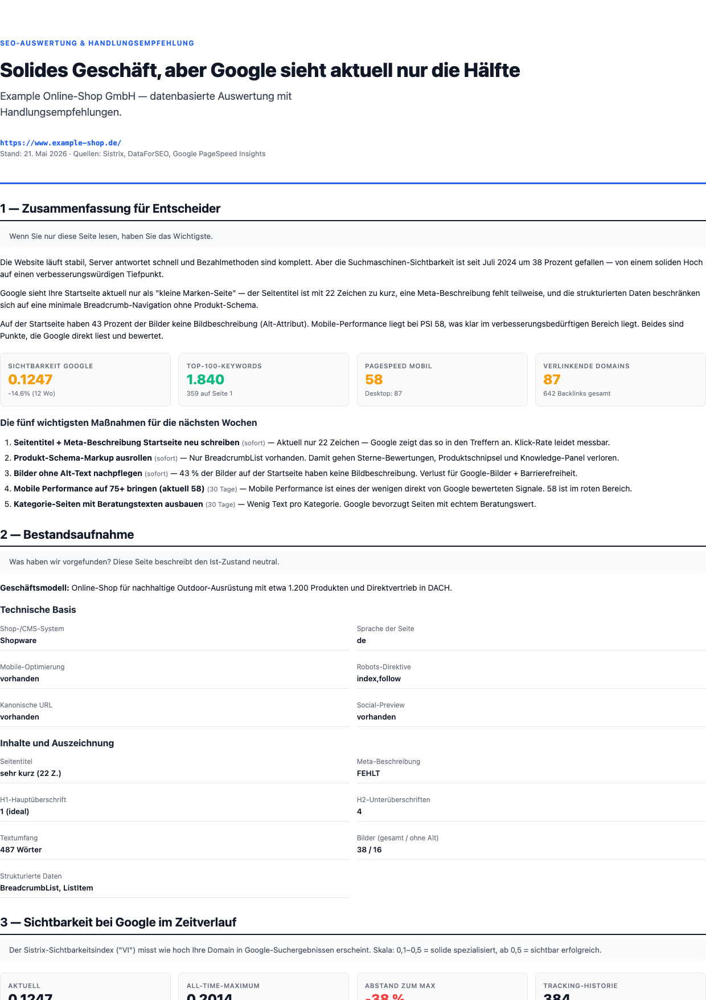

# SEO Survival Kit for Claude Code

> Recovery-first decision support for ecommerce/D2C SEO. Claude Code skills for Core Update recovery diagnosis, prioritized action plans, weekly monitoring, and a Change Governor / Settlement Gate that prevents over-optimizing during recovery windows. Built during a real ecommerce Core-Update recovery case in 2026 and corrected against five months of re-measurement. Most rules are single-case observations (N=1), labelled as such. Open-source, MIT, zero runtime dependencies.

[](https://opensource.org/licenses/MIT)
[](https://code.claude.com/)
[](./CHANGELOG.md)

**v0.5.6 shipped.** Public beta. Breaking changes possible before v1.0. Pin to a tag for reproducible installs. See [CHANGELOG.md](./CHANGELOG.md).

## Start here

Three common entry points. Pick the one that matches your situation:

**1. Traffic dropped after a Google Core Update**
```
/seo-rescue:post-core-update-recovery example.com
```
Diagnosis tree + four-phase Authority-First recovery plan (first movement after 3–4 months, full recovery usually 9–18 months, no 4-week magic promises). Works with a free Google Search Console export; Sistrix and DataForSEO are optional.

**2. Free technical health check before deciding on paid tools**
```
/seo-rescue:seo-audit-free example.com
```
Free-tier check using only Google's surfaces (GSC + PSI + Lighthouse + curl). No paid keys required; a free PSI key is recommended (without one the PageSpeed call often answers HTTP 429, and the skill then points you to local Lighthouse). The skill text and its report template are in German; ask Claude to answer in English and it runs the same steps in English.

**3. Weekly recovery review using your Sistrix CSV exports**
```
/seo-rescue:sistrix-monday-recovery-check current.csv previous.csv example.com
```
17-section structured report. CSV-first, no Sistrix API key required. No exports at hand? The plugin ships a synthetic pair in `skills/sistrix-monday-recovery-check/examples/` (in the repository also under [`examples/synthetic-sistrix-monday-check/`](./examples/synthetic-sistrix-monday-check/), with the expected report), so you can try the skill before you have own data.

**Typical sequence:** diagnose → recovery plan → weekly monitoring. Every step ends with an operator-reviewable artifact. **No autonomous live changes are made by any skill or command.**

## Positioning

Recovery-first decision intelligence for ecommerce and D2C. Most SEO tools answer *what is technically wrong*. This framework answers *given everything I know, what should I do next, what should I leave alone right now, and what should wait*. It complements technical-audit suites (`claude-seo` and similar); it does not replace them.

## What this helps you decide

- Should this URL be protected or changed right now?
- Is this recovery signal real, or is the visibility index lagging real ranking gains?
- Are winners being offset by a few large losers, masking aggregate movement?
- Which keywords are commercially important enough to protect at all costs?
- Is now the wrong time for URL consolidation, title rewrites, or template changes?
- Should we increase paid spend, or fix margin / tracking / landing pages first?
- Which channel is profitable, which is bleeding, which to wind down?
- Which AI surfaces (AI Overview, ChatGPT, Perplexity) are currently citing the site — as a supporting signal, not a primary metric.

## What this is NOT

- Not an autonomous SEO system. Every recommendation is reviewed by the operator.
- Not a full-service marketing agency. Execution belongs to the operator's team, agency, or contractors.
- Not a generic AI growth platform. The focus is recovery-first decision support for ecommerce/D2C, not breadth across all marketing surfaces.
- Not automatic ad optimization. No write actions to any ad account. No automatic budget changes.
- Not a guarantee. Every output carries calibrated confidence; the framework refuses to promise rankings, revenue, or timelines.

## Safety: Change Governor and Settlement Gate

The kit is not designed to execute SEO changes autonomously. Two safety layers sit between the operator and any live modification:

**Change Governor.** Every session starts in `audit_only` mode with zero change budget. Mode escalation requires explicit operator instruction. Each proposed change is rated on risk, evidence quality, rollback readiness, and approval state — actions without a clear data basis can never be classified as `green` risk.

**Settlement Gate.** After a Major Batch of live changes, the gate hard-blocks new optimization waves until enough data has accumulated to attribute cause and effect. The most dangerous moment in recovery is not the first mistake — it is the impulse to keep optimizing immediately afterwards. The gate enforces a waiting period during which only monitoring, QA, rollback prep, and verified emergencies are allowed.

**Goal.** Don't change too much at once. Protect winners. Keep cause-and-effect measurable. **No live SEO change without operator review.**

Canonical references:
- [`plugins/seo-rescue/references/SEO_CHANGE_GOVERNOR.md`](./plugins/seo-rescue/references/SEO_CHANGE_GOVERNOR.md) — modes, budgets, escalation rules
- [`plugins/seo-rescue/references/SEO_SETTLEMENT_GATE.md`](./plugins/seo-rescue/references/SEO_SETTLEMENT_GATE.md) — hard-block definition, exceptions, unlock criteria
- [`plugins/seo-rescue/references/SAFE_LIVE_CHANGE_RULES.md`](./plugins/seo-rescue/references/SAFE_LIVE_CHANGE_RULES.md) — pre/post-crawl rules, batch limits, user-pressure responses
- [`plugins/seo-rescue/docs/LIVE_CHANGE_QA.md`](./plugins/seo-rescue/docs/LIVE_CHANGE_QA.md) — live-change QA workflow
- [`plugins/seo-rescue/commands/recovery-audit.md`](./plugins/seo-rescue/commands/recovery-audit.md) — change-budget audit command

## Naming at a glance

| Refers to | Name |
|---|---|
| Repository / marketplace | `seo-survival-kit` |
| Plugin (technical) | `seo-rescue` |
| Slash commands | `/seo-rescue:rescue`, `/seo-rescue:seo-audit-free`, … |

The split is intentional (marketplace is the brand, plugin is the technical handle).

Six names exist twice, once under `commands/` and once under `skills/`: `recovery-diagnose`, `recovery-crawl`, `recovery-audit`, `recovery-plan`, `recovery-monitor`, `recovery-full`. The file in `commands/` is the specification and the one that counts; the `SKILL.md` of the same name is a thin wrapper of a few lines that exists so the plugin's skill discovery finds the command, and it only tells Claude to read and follow the command file. The two declare different pre-approved tools (the command includes MCP tools, the wrapper does not), so through the wrapper Claude Code may ask for permission before an MCP call.

## What's in the kit

The orchestrator (`/seo-rescue:rescue`) routes to the right skill or command; each can also be called directly. Detailed skill registry: [ARCHITECTURE.md section 4](./ARCHITECTURE.md#4-modules-and-skill-registry).

**Core recovery workflow**

| Command | What it does | Cost |
|---|---|---|
| `/seo-rescue:post-core-update-recovery <domain>` | Core-Update diagnose tree + 4-phase Authority-First recovery plan | free |
| `/seo-rescue:recovery-diagnose <domain>` | Diagnosis with capability-based provider fallbacks (Sistrix + DataForSEO + GSC, with CSV fallbacks) | ~$0.05–$0.50 |
| `/seo-rescue:recovery-crawl <domain>` | Crawl + severity-classified issues (Screaming Frog MCP or CSV-import fallback) | free |
| `/seo-rescue:recovery-audit <domain> [--days 14]` | Read-only change audit: Settlement-Gate-State + hypothesis registry | free |
| `/seo-rescue:recovery-plan <domain>` | Prioritized 30/60/90-day plan with Do-Not-Touch + human approval gate | free |
| `/seo-rescue:recovery-monitor <domain>` | Weekly tracking with deterministic 0-100 recovery score (`null` when data is insufficient) | free with hand-entered or CSV values; Sistrix / DataForSEO calls if configured |
| `/seo-rescue:recovery-full <domain>` | Full sequence: diagnose → crawl → audit → plan → monitor | ~$0.05–$0.50 |
| `/seo-rescue:sistrix-monday-recovery-check <current.csv> <previous.csv> [domain?]` | CSV-first weekly review, 17-section structured report | free |

**Diagnostic and analysis**

| Command | What it does | Cost |
|---|---|---|
| `/seo-rescue:seo-audit-free <domain>` | Free-tier health check (GSC + PSI + Lighthouse + curl) | free |
| `/seo-rescue:gsc-deep-dive <domain> [days?]` | One-call Google Search Console snapshot | free |
| `/seo-rescue:competitor-deep-audit <domain>` | DataForSEO SERP-overlap + keyword-gap analysis | ~$0.10–$0.50 |
| `/seo-rescue:target-keyword-set <domain>` | Target keyword set from existing rankings, grouped by kind of work; editorial-share + season calendar | ~$0.01–$0.10 |
| `/seo-rescue:psi-weekly-cron-baseline` | Automated weekly PSI tracking with regression alerts | free |

**Reporting and economics**

| Command | What it does | Cost |
|---|---|---|
| `/seo-rescue:seo-outreach-report <domain>` | 10-chapter A4 PDF for non-technical decision-makers | ~0.15–0.75 (Sistrix credits + DataForSEO, see [COSTS.md](./COSTS.md)) |
| `/seo-rescue:channel-economics-analyzer` | Per-channel P&L from your marketplace CSVs (Amazon, OTTO, eBay, Zalando, …) | free (your CSVs) |
| `/seo-rescue:subscription-monetization-audit [domain \| --csv]` | 5-lever recurring-revenue playbook; optional Stripe/Chargebee/Recurly CSV import for MRR / ARPU / churn / cohort analysis | free (your CSVs) |

**AI surface (experimental visibility layer)**

| Command | What it does | Cost |
|---|---|---|
| `/seo-rescue:ai-search-rescue <domain>` | Diagnosis + framework for AI Overview / ChatGPT / Perplexity citation patterns | free |
| `/seo-rescue:ai-citations-tracker` | Weekly tracker for brand citations in ChatGPT + Perplexity (NDJSON history) | ~$0.10/year |

> AI surfaces are an experimental visibility layer. Citation tracking and diagnosis only — not a guarantee of AI search traffic. Use as a supporting signal alongside classical search data, not as the sole basis for decisions.

## Architecture and documentation

| Doc | Purpose |
|---|---|
| [ARCHITECTURE.md](./ARCHITECTURE.md) | Canonical source of truth: vision, positioning, system shape, modules, governance, privacy, adaptive onboarding, knowledge layer, what is NOT implemented |
| [RECOVERY_SYSTEM.md](./plugins/seo-rescue/references/RECOVERY_SYSTEM.md) | Six-stage recovery framework, Recovery Risk Engine, Money Keyword Protection, Winner/Loser Neutralization, URL Recovery Analysis, Recovery Signal Score, five-phase sequencing, Settlement Gate. Canonical copy lives in the plugin (`plugins/seo-rescue/references/`); the root [RECOVERY_SYSTEM.md](./RECOVERY_SYSTEM.md) is a pointer stub |
| [DECISION_ENGINE.md](./plugins/seo-rescue/references/DECISION_ENGINE.md) | Decision rules catalog, evidence weighting, data quality, profitability signals, prioritization, sequencing, cross-channel signals. Canonical copy lives in the plugin (`plugins/seo-rescue/references/`); the root [DECISION_ENGINE.md](./DECISION_ENGINE.md) is a pointer stub |
| [SISTRIX_MONDAY_RECOVERY_CHECK.md](./plugins/seo-rescue/references/SISTRIX_MONDAY_RECOVERY_CHECK.md) | Weekly CSV-first workflow specification (canonical copy; the root file is a pointer stub) — runnable skill at [`plugins/seo-rescue/skills/sistrix-monday-recovery-check/`](./plugins/seo-rescue/skills/sistrix-monday-recovery-check/) with synthetic example at [`examples/synthetic-sistrix-monday-check/`](./examples/synthetic-sistrix-monday-check/) |
| [ROADMAP.md](./ROADMAP.md) | Version-by-version product plan |
| [ROADMAP-2026.md](./ROADMAP-2026.md) | Google search future-watch (separate from product roadmap) |

## Installation

Pinned to a tag (reproducible, survives upstream changes):

```shell
/plugin marketplace add maxschottke-spec/seo-survival-kit#v0.5.6
/plugin install seo-rescue@seo-survival-kit
/reload-plugins
```

Always-latest (less safe — a maintainer-account compromise would propagate on next reload):

```shell
/plugin marketplace add maxschottke-spec/seo-survival-kit
/plugin install seo-rescue@seo-survival-kit
/reload-plugins
```

See [SECURITY.md → How to verify before trusting](./SECURITY.md#how-to-verify-before-trusting).

### Outside Claude Code

The three pure-Markdown framework skills (`post-core-update-recovery`, `ai-search-rescue`, and the orchestrator overview `seo-rescue-overview`) are available as platform-agnostic Markdown in [`exports/`](./exports/) with install snippets for Cursor, OpenAI Custom GPT, Gemini CLI, Aider, Continue.dev, and Codex. Script-backed skills remain Claude-Code-specific; MCP wrapper planned for v1.0+.

## Before you run anything

| File | Why |
|---|---|
| [COSTS.md](./COSTS.md) | Which of the 19 skills needs which key, what a run costs, and what works without the key. `seo-outreach-report` uses three APIs, about 0.15–0.75 per domain. |
| [SECURITY.md](./SECURITY.md) | What the scripts access, what they don't, how to verify. |
| [MATURITY.md](./MATURITY.md) | Honest comparison with mature alternatives. |
| [ONBOARDING.md](./ONBOARDING.md) | Three free entry points without keys, then install to first PDF (needs paid Sistrix and DataForSEO access). |

`post-core-update-recovery` is free. `seo-outreach-report` requires API credentials for Sistrix + DataForSEO + Google PSI — full walkthrough in [ONBOARDING.md](./ONBOARDING.md).

## Verify your install

From a clone of the repository, with Node.js 20.6 or newer. None of these calls an API or needs a key; each prints its checks and exits 0 on success. The first line sends everything the tests write into a throwaway directory instead of `~/.cache/seo-rescue`.

```bash
export SEO_CACHE_DIR="$(mktemp -d)"

T=plugins/seo-rescue/test-fixtures/ecommerce-recovery
node $T/lib-safe-primitives.test.js          # safety primitives in lib/safe.js (55 checks)
node $T/recovery-scripts-cache-dir.test.js   # --cache-dir, --dry-run, no empty history entries
node $T/pre-hit-baseline.test.js             # befund field pre_hit_baseline
node $T/stage-status.test.js                 # befund field stage_status
node $T/core-updates-laufend.test.js         # CORE_UPDATES.md table, rollout still running
node $T/quiet-death-detect.test.js           # quiet-death detector of gsc-deep-dive
node $T/monday-example.test.js               # Monday-check example matches its CSVs

node plugins/seo-rescue/skills/seo-outreach-report/weekly-noise.js --selftest
node plugins/seo-rescue/skills/target-keyword-set/target-keyword-set.js --selftest
```

The same nine commands run in CI on every push and pull request ([`.github/workflows/validate.yml`](./.github/workflows/validate.yml)). They test the scripts and the data contracts. They do not test the prose workflows that Claude executes, and there is no end-to-end run against live APIs, see [MATURITY.md](./MATURITY.md).

A safe first run of a script that would normally write to your cache:

```bash
node plugins/seo-rescue/scripts/recovery-monitor.js --domain example.com --vi 0.42 --keywords-t10 12 --dry-run
```

## Sample output

Same layout you get for a real domain — 10 chapters, ~1 MB PDF, plain language for non-technical decision-makers:



Full sample: [examples/sample-audit.pdf](./examples/sample-audit.pdf). The use-case pattern (a sharp drop within 2-3 weeks after a published Core Update) is illustrated with synthetic data in [examples/screenshots/02-core-update-crash-case.png](./examples/screenshots/02-core-update-crash-case.png) and [ROADMAP-2026.md](./ROADMAP-2026.md).

## When to use

- Organic traffic dropped during or shortly after a published Google Core Update. Recovery framework provides a phased Authority-First plan with realistic horizons (first movement after 3–4 months, full recovery usually 9–18 months).
- A non-technical decision-maker (shop owner, founder, executive) needs to understand the SEO state. Outreach-report pipeline produces a decision-maker A4 PDF.
- No budget for paid SEO tools, want a free-tier health check. `seo-audit-free` is the entry.
- Multi-marketplace ecommerce, need to know which channel is profitable. Channel-economics-analyzer computes per-channel break-even and operating margin from your CSVs.
- Weekly PSI monitoring with regression detection. Free over PSI v5 quota.
- You want to track AI surface citation patterns (AI Overview, ChatGPT, Perplexity) as a supporting signal alongside classical rankings — not as a primary growth driver.

## When not to use

- The site is brand new (< 6 months). That is a build-up phase, not a rescue phase.
- You need a deep technical audit (crawlability, schema validation, CWV across hundreds of URLs). Use `claude-seo` instead. This complements it.
- You need 4-week magic recovery. The framework is explicit about 9–18 month horizons for Core Update damage.
- You need production-grade guarantees, SLAs, or enterprise contracts. Public beta, single-maintainer.

## Use-case fit

This system is currently strongest for ecommerce/D2C recovery workflows, especially when SEO data can be evaluated against revenue, margin, inventory, returns, conversion, and paid-media context.

| Website type | Fit | Notes |
|---|---|---|
| Ecommerce / D2C | Core fit | Strongest current use case. Product, category, margin, inventory, return and conversion data make recovery decisions more reliable. |
| Lead generation / B2B | Good fit with adaptation | Replace product revenue with lead quality, pipeline, CPL and sales-cycle data. |
| SaaS | Good fit with adaptation | Use signup, activation, demo, trial and pipeline metrics instead of shop revenue. |
| Local service | Partial fit | Works when calls, forms, location pages and lead quality can be measured reliably. |
| Publisher / News | Special case | Requires freshness, topical authority, Discover/News visibility and ad/affiliate revenue logic. Not the current core model. |
| Affiliate / Comparison | Partial fit | Needs EPC, merchant mix, SERP intent and monetization quality. |
| YMYL / regulated content | Caution | Requires stricter evidence standards and additional expert/legal review where applicable. |

The framework should not be treated as a universal SEO automation system. Each website type needs its own business-signal layer.

## YMYL notice

For Your-Money-Your-Life sites (medical, legal, financial, regulated), have a domain expert review the action plan before client delivery. The framework treats sites uniformly at the SEO-mechanics level; it does not validate domain-specific compliance.

## Real-world basis

Skills were built from one extended Core-Update recovery case (mid-size DE ecommerce shop, March/April 2026 update window) and applied to four additional real-world domain audits in May 2026. The case did not end in a documented recovery, and several early findings were later withdrawn (see [CHANGELOG.md](./CHANGELOG.md), 0.5.5 → Corrected). Patterns in skill `LESSONS.md` files are observations from this case base, not population statistics — treat as starting hypotheses to test in your own context.

The open repo is a first-pass methodology and decision-support layer. It helps identify recovery signals, risky changes, protected URLs, winner/loser patterns, missing data, and validation steps. It is not the same as a calibrated recovery engagement that brings private business context into the decision. Deeper recovery work needs data the open repo does not see: GSC/SISTRIX history, shop revenue, margin, returns, inventory, paid-media context, implementation history, competitive context, and operator review to weigh conflicting signals.

## Need help running this on your own site?

The plugin is MIT and self-serve. If you'd rather have someone with operational experience walk you through it on your specific case, the maintainer offers paid engagements:

| Engagement | What you get | Typical scope |
|---|---|---|
| **Recovery Audit (fixed)** | Full diagnose-PDF + 60-min strategy call + 4-phase 6-12 month plan | One domain, one Core-Update or AI-search problem |
| **Recovery Retainer (ongoing advisory)** | Monthly reviews, plan adjustments, prioritization help | 3-6 months, weekly to bi-weekly cadence |
| **Outreach pipeline setup** | Configured pipeline + first 5 PDFs + handoff | One-time, for agencies that want decision-maker deliverables |

Contact: open a [Discussion](https://github.com/maxschottke-spec/seo-survival-kit/discussions).

## Contributors

- [Max Schottke](https://github.com/maxschottke-spec) — maintainer, original skills, plugin packaging
- [Jeronzo](https://github.com/kamehamea-art) — independent security review (audit 2026-05-22 surfaced the data-leak surface, prompt-injection chain, and `allowed-tools` hardening that landed in the v0.3.x security sprint)

## Status

Single-maintainer open-source project. No SLA, no commercial support. Issue response best-effort within a few days. For production-critical workflows, pin to a specific tag and review releases before upgrading. The currently shipping version is stated at the top of this README and in [CHANGELOG.md](./CHANGELOG.md).

## License, security, contributing

MIT. See [LICENSE](./LICENSE) and [SECURITY.md](./SECURITY.md). Contributing: no CONTRIBUTING.md yet — please [open an issue](https://github.com/maxschottke-spec/seo-survival-kit/issues) first for larger changes.
